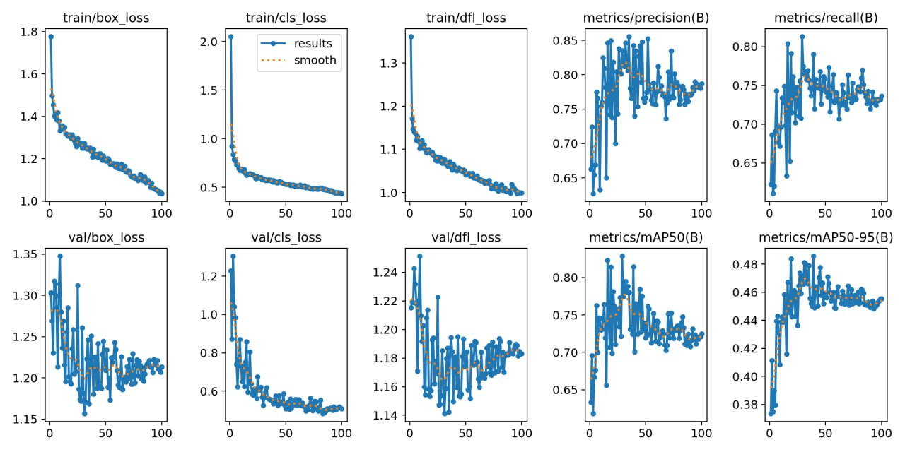
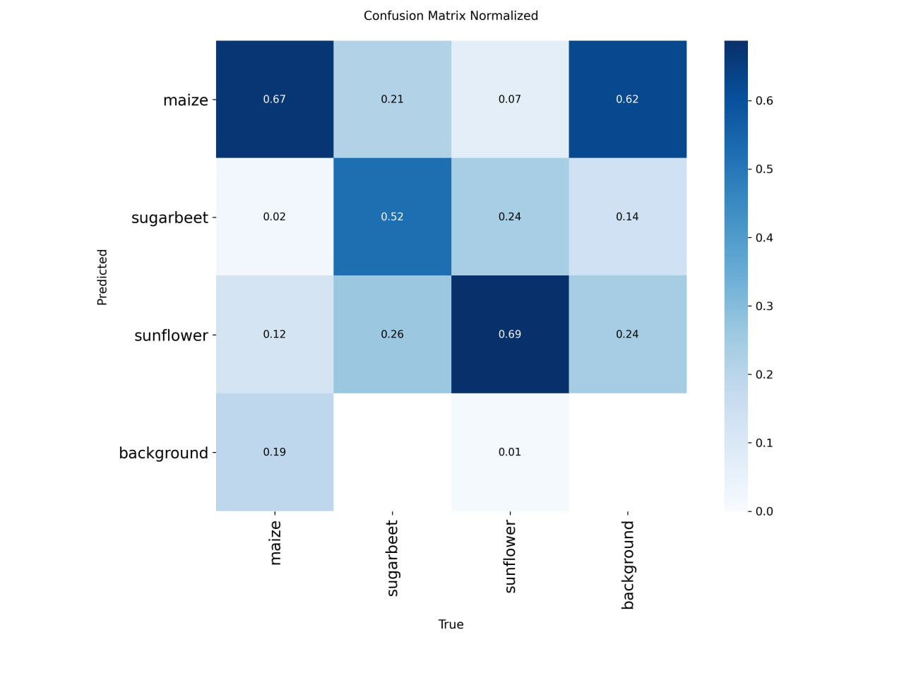
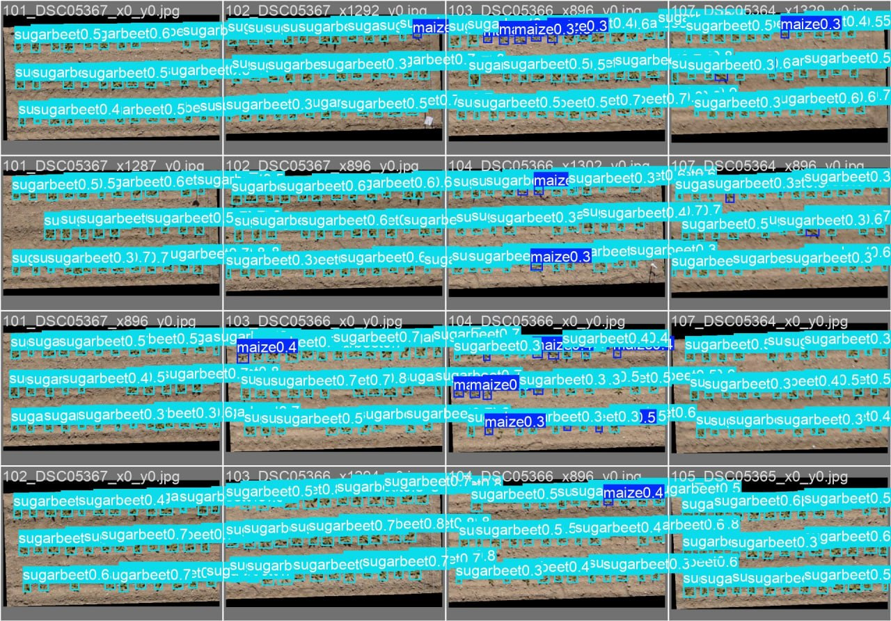

# Detección y Conteo de Cultivos en Imágenes de VANT/Drones mediante YOLO11

**Dataset de referencia:** *Plant Detection and Counting from High-Resolution RGB Images Acquired from UAVs* (INRAE / Arvalis / ITB / Hiphen).  
**Especies evaluadas:** Maíz (*Zea mays*), Remolacha azucarera (*Beta vulgaris*), Girasol (*Helianthus annuus*).

---

## 1. Resumen Ejecutivo del Proyecto

El presente proyecto implementa un pipeline integral de visión artificial para la **detección y conteo automatizado de plántulas agrícolas en estadios tempranos de emergencia** a partir de ortomosaicos aéreos capturados por vehículos aéreos no tripulados (VANT / drones).

El objetivo es permitir la estimación precisa de la **densidad de población de plantas**, una métrica crítica para la toma de decisiones agronómicas (re-siembra, fertilización variable, control de malezas y pronóstico de rendimiento).

### Aspectos Destacados
- **Ingeniería de datos a gran escala:** Procesamiento de ortofotos de 24 megapíxeles ($6000 \times 4000$ px) mediante una técnica de *tiling* optimizada de $1024 \times 1024$ px con solapamiento y filtrado de recorte.
- **Partición estricta anti-fuga (*Zero Data Leakage*):** Agrupamiento y estratificación a nivel de vuelo y sitio geográfico (`site_flight`), asegurando que las evaluaciones en validación y prueba se realicen sobre vuelos completamente independientes.
- **Eficiencia y rendimiento:** Modelo **YOLO11n** entrenado durante 100 épocas en GPU Tesla T4 (51 minutos de entrenamiento, 5.6 MB de peso, 36 ms por tile), alcanzando un **$mAP_{50}$ global del 81.4%**, con desempeños sobresalientes del **98.0% en remolacha** y **96.9% en girasol**.

---

## 2. Dataset y Metodología de Partición

El benchmark original proviene del estudio de *David et al. (2021)* y está compuesto por 189 capturas aéreas en formato Supervisely con más de 16.000 anotaciones rectangulares y metadatos de vuelo (sitio, fecha, cultivo, altitud, espaciamiento entre hileras).

### Pipeline de Conversión y Tiling (`supervisely_to_yolo.py`)
Dado que las redes neuronales estándar reescalan imágenes grandes perdiendo el detalle de plántulas de pocos píxeles, se desarrolló un conversor a medida que realiza:

1. **Ventana deslizante (Tiling de 1024 px):** Corte regular de imágenes con solapamiento de 128 px para no perder plantas ubicadas sobre los bordes de corte.
2. **Filtrado de cajas parciales:** Conservación únicamente de aquellas anotaciones con $\ge 50\%$ de su área dentro del tile, recalculando coordenadas normalizadas relativas al tile.
3. **División por grupos de vuelo (`site_flight`):** 
   - Se identificaron 23 vuelos y 16 sitios distintos (Thenay, Charmont, Bucy, Auzeville, Memmie, etc.).
   - Se estratificó por cultivo para garantizar la presencia de las 3 clases en todos los subconjuntos.

| Subconjunto | Grupos de Vuelo | Tiles Generados ($1024\times 1024$) | Cajas Anotadas |
| :--- | :---: | :---: | :---: |
| **Train** | 17 vuelos | 760 | 19.928 |
| **Validation** | 3 vuelos | 186 | 3.761 |
| **Test** | 3 vuelos | 81 | 2.520 |
| **Total** | **23 vuelos** | **1.027** | **26.209** |

---

## 3. Entrenamiento del Modelo

- **Framework:** Ultralytics YOLOv11 (versión 8.4)
- **Backbone / Arquitectura:** `yolo11n.pt` (101 capas, 2.597.537 parámetros, 6.4 GFLOPs)
- **Resolución de entrada:** $imgsz = 1024$
- **Hiperparámetros:** Batch size = 16, Épocas = 100, Optimizador Auto (AdamW/SGD), Desactivación de mosaico en últimas 10 épocas (`close_mosaic = 10`).
- **Hardware:** Google Colab NVIDIA Tesla T4 (15 GB VRAM). Tiempo total: 0.851 horas (51 min).

---

## 4. Resultados y Métricas de Rendimiento

### Métricas en Conjunto de Validación

| Clase | Imágenes | Instancias | Precisión ($P$) | Exhaustividad / Recall ($R$) | $mAP_{50}$ | $mAP_{50-95}$ |
| :--- | :---: | :---: | :---: | :---: | :---: | :---: |
| **Todas las clases** | **186** | **3.761** | **0.843 (84.3%)** | **0.790 (79.0%)** | **0.814 (81.4%)** | **0.486 (48.6%)** |
| Remolacha (*Sugarbeet*) | 45 | 1.629 | **0.991 (99.1%)** | **0.917 (91.7%)** | **0.980 (98.0%)** | 0.595 |
| Girasol (*Sunflower*) | 120 | 1.469 | **0.929 (92.9%)** | **0.939 (93.9%)** | **0.969 (96.9%)** | 0.719 |
| Maíz (*Maize*) | 21 | 663 | 0.609 (60.9%) | 0.513 (51.3%) | 0.493 (49.3%) | 0.143 |

### Métricas en Conjunto de Prueba Independiente (Test Split - Vuelos no vistos)

Evaluación final sobre los 81 tiles de vuelos completamente ciegos para el modelo:

| Clase | Imágenes | Instancias | Precisión ($P$) | Exhaustividad / Recall ($R$) | $mAP_{50}$ | $mAP_{50-95}$ |
| :--- | :---: | :---: | :---: | :---: | :---: | :---: |
| **Todas las clases** | **81** | **2.520** | **0.788 (78.8%)** | **0.775 (77.5%)** | **0.862 (86.2%)** | **0.433 (43.3%)** |
| Maíz (*Maize*) | 27 | 803 | 0.668 (66.8%) | **0.897 (89.7%)** | **0.861 (86.1%)** | 0.338 |
| Girasol (*Sunflower*) | 54 | 1.717 | **0.908 (90.8%)** | 0.653 (65.3%) | **0.863 (86.3%)** | 0.528 |

> **Hallazgo Sobresaliente en Test:** El modelo generalizó de forma excepcional en maíz sobre vuelos no vistos, alcanzando un **$mAP_{50}$ del 86.1%** y un **Recall del 89.7%** (detectó prácticamente 9 de cada 10 plantas de maíz), demostrando que la caída en validación se debió a particularidades de un único vuelo y no a una incapacidad del modelo para aprender la especie.

### Curvas de Aprendizaje a lo largo de las 100 Épocas


---

## 5. Análisis de Errores y Diagnóstico Agronómico (Semana 3)

### Matriz de Confusión y Visualización de Predicciones


*Detecciones sobre ortofotos aéreas en el conjunto de validación:*


El análisis detallado de la matriz de confusión y de las curvas Precision-Recall revela patrones fundamentales vinculados a la biología del cultivo:

### A. Dicotiledóneas (Girasol y Remolacha) $\rightarrow$ Rendimiento Superior ($>96\%$ mAP)
- **Firma morfológica:** Ambas especies presentan cotiledones carnosos y primeras hojas verdaderas anchas, circulares y extendidas horizontalmente respecto al suelo.
- **Firma espectral / Contraste:** Generan una huella verde compacta de alto contraste contra la matriz de suelo (incluso con variación de humedad o rastrojo), facilitando bordes nítidos para las cajas delimitadoras.

### B. Monocotiledóneas (Maíz) $\rightarrow$ Cuello de Botella ($49.3\%$ mAP en Val vs $86.1\%$ en Test)
- **Firma morfológica filiforme:** En estadios V1-V2, el maíz proyecta hojas acintadas, delgadas y erectas. Vistas cenitalmente desde 30-50 m, el área foliar aparente es mínima (a menudo de apenas 3 a 8 píxeles de grosor).
- **Falsos negativos (Recall 51.3% en Val vs 89.7% en Test):** El modelo omite plántulas en emergencia inicial debido a la baja resolución relativa por planta en tiles de 1024 px, aunque generaliza notablemente en vuelos con desarrollo vegetativo más homogéneo.
- **Confusión con fondo/malezas (Precisión 60.9%):** Las grientas de suelo sombreadas y malezas gramíneas tempranas generan falsos positivos ocasionales.
- **Desbalance de datos en validación:** Solo 21 imágenes de validación contenían maíz, frente a 120 de girasol.

---

## 6. Estructura del Repositorio

```text
YOLO-maiz-111026/
│
├── README.md                           # Documentación técnica completa del proyecto
├── supervisely_to_yolo.py              # Conversor de Supervisely a tiles YOLO con split por vuelo
├── dataset_supervisely/                # Dataset original descomprimido (meta.json, ds0/img, ds0/ann)
│
├── assets/                             # Gráficos y visualizaciones para el informe
│   ├── results.jpg                     # Curvas de pérdida y mAP (100 épocas)
│   ├── confusion_matrix_normalized.jpg # Matriz de confusión normalizada
│   └── val_batch0_pred.jpg             # Detecciones visuales con cajas delimitadoras
│
├── plantas_yolo/                       # Dataset procesado en formato Ultralytics
│   ├── data.yaml                       # Configuración de clases y rutas relativas
│   ├── images/                         # Subcarpetas train (760), val (186), test (81)
│   └── labels/                         # Etiquetas normalizadas en formato YOLO
│
├── plantas_yolo.zip                    # Archivo comprimido para despliegue directo en Colab / Cloud
└── plantas_yolo.tar.gz                 # Archivo tar alternativo
```

---

## 7. Instrucciones de Reproducibilidad

### 1. Preparación del Entorno
```bash
git clone <tu-repositorio>
cd YOLO-maiz-111026
pip install pillow ultralytics
```

### 2. Generación de Tiles y División Estratificada
```bash
python supervisely_to_yolo.py dataset_supervisely plantas_yolo --tile 1024 --overlap 128 --val 0.15 --test 0.15
```

### 3. Entrenamiento e Inferencia en Google Colab
```python
from ultralytics import YOLO

# Cargar pesos base
model = YOLO("yolo11n.pt")

# Entrenar
results = model.train(
    data="/content/plantas_yolo/data.yaml",
    imgsz=1024,
    epochs=100,
    batch=16,
    device=0,
    name="inrae_plantas_yolo"
)

# Evaluar en conjunto de prueba independiente
metrics = model.val(data="/content/plantas_yolo/data.yaml", split="test")
```

---

## 8. Conclusiones y Próximos Pasos

1. **Viabilidad probada:** El pipeline resuelve con éxito la detección de emergencia en cultivos de hoja ancha a escala de producción agrícola con inferencia ultrarrápida (36 ms por tile).
2. **Estrategia para el Maíz:** Para elevar el desempeño en maíz a $>85\%$, se recomienda:
   - Probar arquitecturas con mayor resolución espacial o capacidad (`YOLO11s` o `YOLO11m`).
   - Implementar inferencia segmentada con **SAHI** (*Slicing Aided Hyper Inference*) en etapas de post-procesamiento.
   - Aplicar aumentaciones de imagen dirigidas al contraste de verdes (*Color Jitter / CLAHE*).
